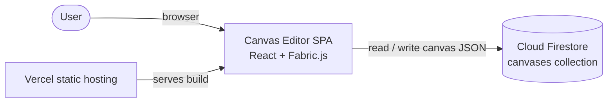
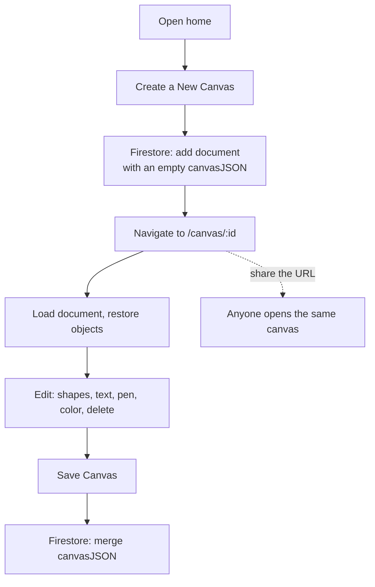

# Canvas Editor: High-Level Design

A minimal web-based 2D editor: create a canvas, add shapes, text and freehand drawings, and save it to the cloud under a shareable link. Live at [canvas.minianon.in](https://canvas.minianon.in). For code-level detail see the [Low-Level Design](lld.md).

## 1. System context

The app is a single-page application with no backend of its own. Firestore is the only server-side component and stores each canvas as a document.

## 2. Components

| Component | Responsibility |
|---|---|
| Home page | Creates a new empty canvas document and redirects to its editor URL |
| Canvas editor page | Loads a canvas by ID, provides drawing tools, saves the canvas |
| Fabric.js canvas | Object model and rendering for rectangles, circles, text and pen strokes |
| Firebase client | Connects to Firestore using `VITE_FIREBASE_*` environment variables |
| Router | `/` (home) and `/canvas/:canvasId` (editor); Vercel rewrites all paths to `index.html` |

## 3. Main flows

## 4. Tech stack

| Layer | Choice | Why |
|---|---|---|
| UI | React 19 + React Router | Simple routing between home and editor |
| Drawing | Fabric.js | Ready-made object model, selection, free drawing and JSON serialization |
| Storage | Cloud Firestore | Serverless document store; a canvas is one JSON document |
| Build | Vite | Fast dev server and static build |
| Hosting | Vercel | Static hosting with SPA rewrites |

## 5. Data

| Collection | Document | Fields |
|---|---|---|
| `canvases` | auto ID (used in the URL) | `canvasJSON` (stringified Fabric.js JSON), `createdAt` |

## 6. Quality attributes

| Attribute | Approach |
|---|---|
| Simplicity | No accounts and no backend code: link-based sharing |
| Persistence | Whole canvas serialized with `canvas.toJSON()` and saved on demand |
| Portability | Canvas state is plain JSON and can be reloaded anywhere |
| Known limits | No auth, so anyone with a link can edit; saving is manual (no autosave); no realtime collaboration |
