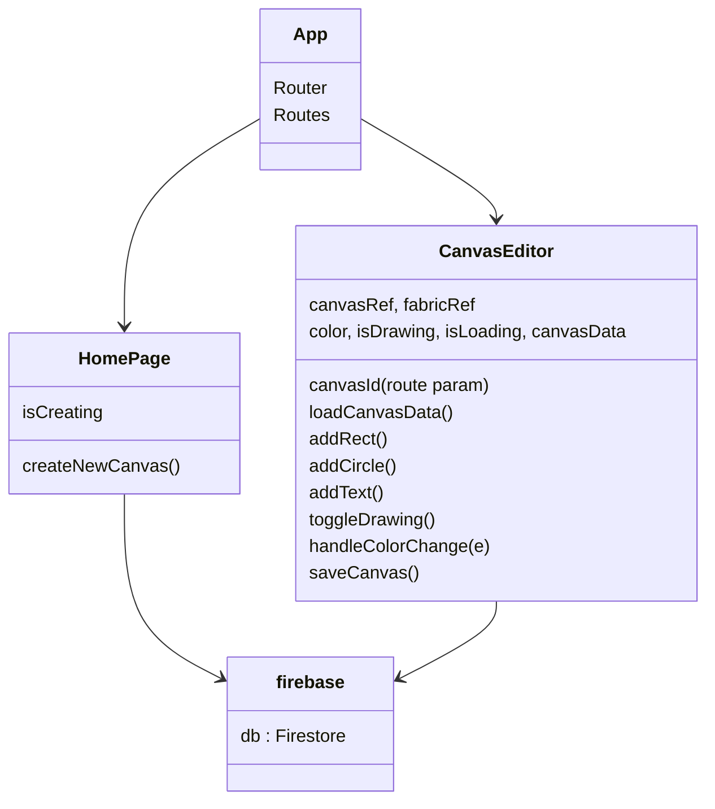
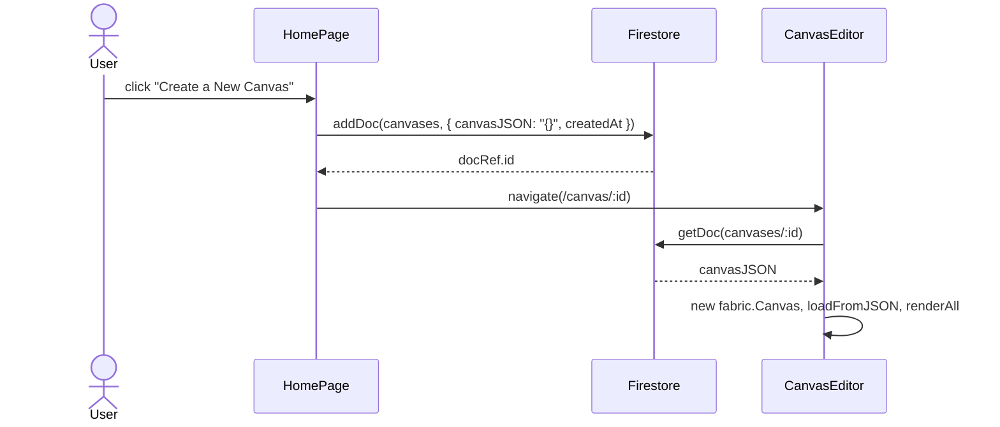
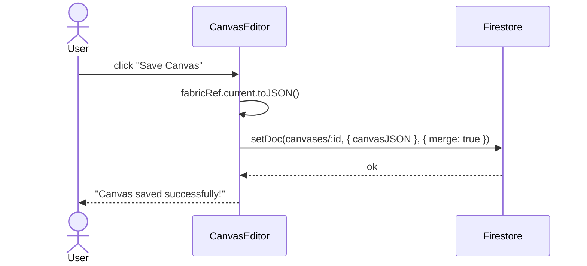

# Canvas Editor: Low-Level Design

Module-level design of the editor. For the big picture see the [High-Level Design](hld.md).

## 1. Source layout

| File | Role |
|---|---|
| `src/main.jsx` | React entry point |
| `src/App.jsx` | Router: `/` → `HomePage`, `/canvas/:canvasId` → `CanvasEditor`; shared `Footer` |
| `src/firebase.js` | Initializes Firebase from `VITE_FIREBASE_*` env vars, exports `db` (Firestore) |
| `src/pages/HomePage.jsx` | "Create a New Canvas" button |
| `src/pages/CanvasEditor.jsx` | Toolbar, Fabric.js canvas, load and save logic |
| `vercel.json` | Rewrites every path to `index.html` so deep links work |

## 2. Components



## 3. Data model

```json
// Firestore: canvases/{canvasId}
{
  "canvasJSON": "{\"version\":\"6.x\",\"objects\":[{\"type\":\"rect\",\"left\":100,\"top\":100,\"fill\":\"#000000\"}]}",
  "createdAt": "Timestamp"
}
```

`canvasJSON` is the string form of `fabric.Canvas.toJSON()`.

## 4. Editor behavior

| Action | Implementation |
|---|---|
| Rectangle | `new fabric.Rect({ left: 100, top: 100, width: 100, height: 100, fill: color })` |
| Circle | `new fabric.Circle({ left: 150, top: 150, radius: 50, fill: color })` |
| Text | `new fabric.Textbox("Edit me", { fontSize: 20, width: 150, fill: color })` |
| Pen tool | Toggles `canvas.isDrawingMode`, uses a `PencilBrush` (width 3) in the current color |
| Color picker | Sets the color for new objects, recolors selected objects and the pen |
| Delete | `Delete` / `Backspace` removes all selected objects |
| Canvas size | 90% of window width × 80% of window height, light grey background |

## 5. Sequences

### Create and open a canvas



### Save



## 6. Lifecycle and cleanup

The Fabric canvas is created after the document has loaded (`isLoading` false). On unmount or reload, the effect removes the keydown listener and calls `canvas.dispose()` so no stale canvas or listeners remain.

## 7. Configuration

| Variable | Purpose |
|---|---|
| `VITE_FIREBASE_API_KEY`, `VITE_FIREBASE_AUTH_DOMAIN`, `VITE_FIREBASE_PROJECT_ID`, `VITE_FIREBASE_STORAGE_BUCKET`, `VITE_FIREBASE_MESSAGING_SENDER_ID`, `VITE_FIREBASE_APP_ID` | Firebase project config, read at build time |
